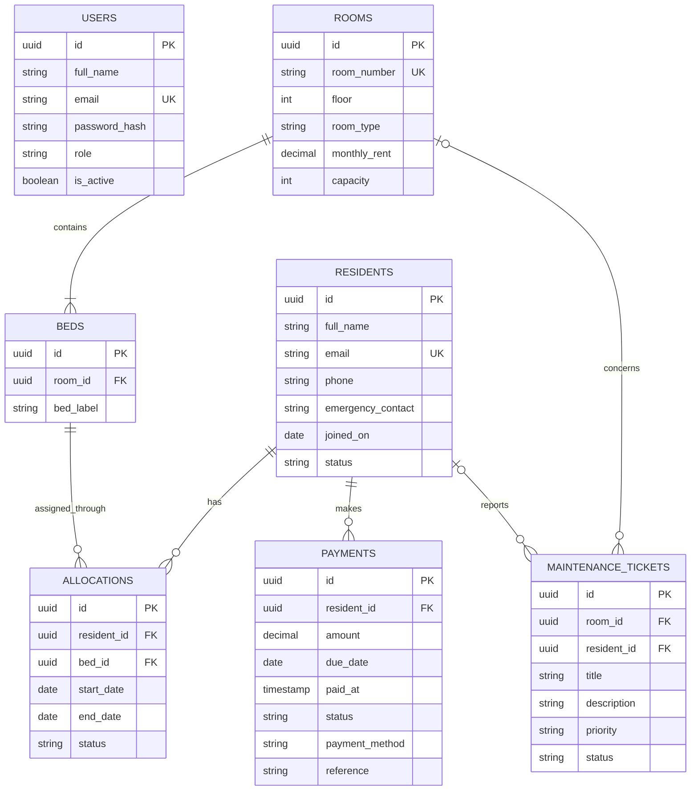

# Haven — Hostel Management System

A full-stack hostel operations MVP built with React, Express, and PostgreSQL. It includes an authenticated staff workspace for resident records, room/bed occupancy, rent payments, and maintenance requests.

## Features

- JWT-based staff sign-in; passwords are stored as bcrypt hashes.
- Change password from the top-right account avatar; verifies the current password, requires a 16-character minimum, and invalidates other signed-in sessions.
- Overview with occupancy, residents, monthly collections, outstanding fees, and open maintenance.
- Create and search residents; optionally assign an available bed on check-in, then check out and release it.
- Create rooms and their beds together in one database transaction.
- Record paid or pending resident fees; mark pending fees paid.
- Create maintenance requests and move them through open, in-progress, and resolved.
- Responsive workspace UI with API error feedback.

## Run locally

Requirements: Node.js 20+, npm, and Docker Desktop (or a PostgreSQL 16 database). For LAN use, the host computer and each device must be on the same Wi-Fi/local network.

1. Copy `.env.example` to `.env`. For local development the example database URL works with the Compose service; replace `JWT_SECRET` with a long random value.
2. Start PostgreSQL: `docker compose up -d db`
3. Install dependencies: `npm install`
4. Initialize the schema and create demo data: `npm run db:seed`
5. Start the LAN-ready website: `npm run start:lan`
6. Open `http://localhost:4000` on the host computer. On another device connected to the same Wi-Fi, open `http://<host-computer-ip>:4000`.

To find the host computer's local IP, run `ipconfig` in Windows and use its IPv4 Address (for example, `192.168.1.24`) for the active Wi-Fi adapter. Keep the terminal and computer on while other devices use the site; this shares one application and one database among those devices. The API and built frontend are both served on port `4000`. The schema is also applied automatically when the API starts. The seed command creates a demo administrator and four sample rooms/beds if no rooms exist. To run the separate development servers instead, use `npm run dev` and open `http://localhost:5173`.

If Windows Firewall prompts, allow Node.js on your **Private network**. If needed, an administrator can explicitly add a private-profile firewall rule in PowerShell:

```powershell
New-NetFirewallRule -DisplayName "Haven Hostel (Private LAN)" -Direction Inbound -Action Allow -Protocol TCP -LocalPort 4000 -Profile Private
```

Do not expose the development/LAN setup directly to the public internet. Its local-network HTTP traffic is not encrypted; public or sensitive production use requires a properly hosted deployment with HTTPS, secure credentials, automated database backups, and individual staff accounts. Client-isolation settings on guest Wi-Fi can also block device-to-device connections.

**Demo login:** `admin@hostel.local` / `ChangeMe123!`. This MVP has no password-management screen or staff-provisioning UI. Before deployment, replace the demo account through a secure operator workflow, use a unique long `JWT_SECRET`, and serve the app over HTTPS. Do not use the sample credentials or secret in production.

## Public internet deployment (Render)

[`render.yaml`](render.yaml) defines the production web service and a private PostgreSQL 16 database in Singapore. The Render web service builds the React frontend and serves it together with the Express API over Render's HTTPS endpoint. The database has no public IP allow list, so only the Render service can reach it. Production enables browser security headers and rate-limits sign-in attempts.

**Public hosting is not activated just by preparing this project.** Render account authentication, billing choices, a GitHub repository linked to Render, and confirmation of the current provider charges are required. The Blueprint intentionally selects paid `starter` web-service and `basic-256mb` database plans, rather than putting residents' or billing data on an expiring hobby database. Review current prices and backup/retention options on Render before approving creation; never expose the database URL or open its IP allow list to the internet.

1. Create a **private** GitHub repository, and push this project to its default branch. Do not upload `.env`, passwords, API tokens, or resident information.
2. Sign in or create an account at [Render](https://dashboard.render.com). Review the web-service and database plan prices before continuing.
3. In Render, select **New → Blueprint**, then connect the repository. Render will read [`render.yaml`](render.yaml) and show the services and planned paid resources for confirmation.
4. Before creating them, set the requested secret variables. `BOOTSTRAP_ADMIN_EMAIL` is your own administrator email, `BOOTSTRAP_ADMIN_PASSWORD` is a new unique password with at least 16 characters, and `BOOTSTRAP_ADMIN_NAME` is your name. Never reuse the local demo password.
5. Review the resource plan, region, and account charges; create the Blueprint only if you approve the displayed costs. Render provisions the private database, runs `npm run db:seed` to apply the schema and create just the first administrator (not the local demo residents or payment records), builds the site, and checks `/api/health`.
6. Once Render marks the web service **Live**, use its `https://…onrender.com` URL to sign in from phones, laptops, or other networks. Register a custom domain in Render if desired.

Free Render web instances can sleep and are not appropriate for hostel operations. Render notes that free Postgres has a limited lifetime and no managed recovery/backups; select suitable paid database retention and arrange independent backups before storing real resident, financial, or emergency-contact data. Keep the database's public-access list closed.

## Database design

PostgreSQL uses UUID primary keys, foreign keys, check constraints, and indexes. The schema is in [`server/sql/schema.sql`](server/sql/schema.sql).



`allocations` is a history table, rather than a room field on the resident: a resident can move rooms without losing their previous stay, and each bed/resident can have at most one active allocation. Partial unique indexes enforce both rules. The API creates a resident and optional allocation in a transaction. A room's capacity is materialized as its bed rows at creation; add a migration before changing bed counts on existing rooms.

`payments` stores each fee/receipt event independently, including due date, status, and payment reference. Maintenance tickets can be attached to a room and/or the reporting resident. Deleting residents is intentionally restricted by foreign keys so financial and allocation history is not silently lost.

### Main API routes

All routes except health check and login require a bearer token.

| Method | Route | Purpose |
| --- | --- | --- |
| `GET` | `/api/health` | Database health |
| `POST` | `/api/auth/login` | Sign in |
| `GET` | `/api/auth/me` | Current staff profile |
| `POST` | `/api/auth/change-password` | Verify current password and update the staff password |
| `GET` | `/api/dashboard` | Dashboard totals and recent residents |
| `GET`, `POST` | `/api/residents` | List or check in a resident |
| `PATCH` | `/api/residents/:id/check-out` | Check out a resident and end their allocation |
| `GET` | `/api/beds/available` | Available beds for check-in |
| `GET`, `POST` | `/api/rooms` | List rooms or create a room and beds |
| `GET`, `POST` | `/api/payments` | List or record a fee |
| `PATCH` | `/api/payments/:id/mark-paid` | Collect a pending fee |
| `GET`, `POST` | `/api/maintenance` | List or create a request |
| `PATCH` | `/api/maintenance/:id/status` | Update request progress |
