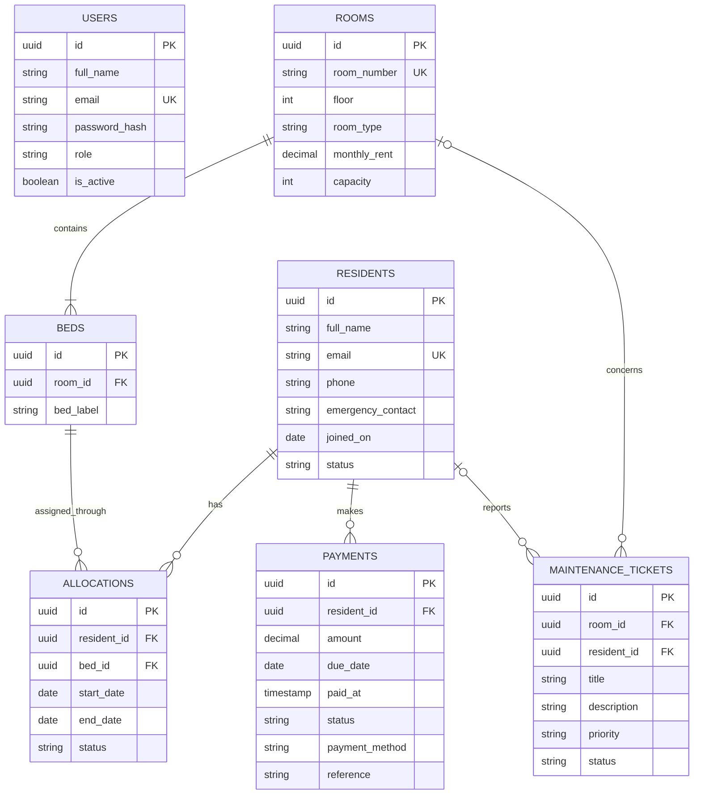

# Sazzad — Hostel Management System

A full-stack hostel operations MVP built with React, Express, and PostgreSQL. It includes an authenticated staff workspace for resident records, room/bed occupancy, rent payments, and maintenance requests.

## Features

- JWT-based staff sign-in; passwords are stored as bcrypt hashes.
- Change password from the top-right account avatar; verifies the current password, requires a 16-character minimum, and invalidates other signed-in sessions.
- Overview with occupancy, residents, monthly collections, outstanding fees, and open maintenance.
- Create and search residents; optionally assign an available bed on check-in, then check out and release it.
- Create rooms and their beds together in one database transaction.
- Record paid or pending resident fees; mark pending fees paid.
- Create maintenance requests and move them through open, in-progress, and resolved.
- Responsive workspace UI with API error feedback.

## Run locally

Requirements: Node.js 20+, npm, and Docker Desktop (or a PostgreSQL 16 database). For LAN use, the host computer and each device must be on the same Wi-Fi/local network.

1. Copy `.env.example` to `.env`. For local development the example database URL works with the Compose service; replace `JWT_SECRET` with a long random value.
2. Start PostgreSQL: `docker compose up -d db`
3. Install dependencies: `npm install`
4. Initialize the schema and create demo data: `npm run db:seed`
5. Start the LAN-ready website: `npm run start:lan`
6. Open `http://localhost:4000` on the host computer. On another device connected to the same Wi-Fi, open `http://<host-computer-ip>:4000`.

To find the host computer's local IP, run `ipconfig` in Windows and use its IPv4 Address (for example, `192.168.1.24`) for the active Wi-Fi adapter. Keep the terminal and computer on while other devices use the site; this shares one application and one database among those devices. The API and built frontend are both served on port `4000`. The schema is also applied automatically when the API starts. The seed command creates a demo administrator and four sample rooms/beds if no rooms exist. To run the separate development servers instead, use `npm run dev` and open `http://localhost:5173`.

If Windows Firewall prompts, allow Node.js on your **Private network**. If needed, an administrator can explicitly add a private-profile firewall rule in PowerShell:

```powershell
New-NetFirewallRule -DisplayName "Haven Hostel (Private LAN)" -Direction Inbound -Action Allow -Protocol TCP -LocalPort 4000 -Profile Private
```

Do not expose the development/LAN setup directly to the public internet. Its local-network HTTP traffic is not encrypted; public or sensitive production use requires a properly hosted deployment with HTTPS, secure credentials, automated database backups, and individual staff accounts. Client-isolation settings on guest Wi-Fi can also block device-to-device connections.

**Demo login:** `admin@hostel.local` / `ChangeMe123!`. This MVP has no password-management screen or staff-provisioning UI. Before deployment, replace the demo account through a secure operator workflow, use a unique long `JWT_SECRET`, and serve the app over HTTPS. Do not use the sample credentials or secret in production.

## Public website on GitHub Pages + secure API on Render

GitHub Pages serves static files; it cannot run Express or PostgreSQL. The existing public Pages address currently shows the repository's README, not the app. This project includes [`deploy-pages.yml`](.github/workflows/deploy-pages.yml) so Actions can build and publish the actual mobile-responsive React frontend at `https://mrsazzad-dev.github.io/Hostel-Management-System/`, while a Render HTTPS web service runs the API and a private PostgreSQL database.

### Publish and connect both services

1. **Publish the project files** to the `main` branch of `mrsazzad-dev/Hostel-Management-System`. Keep `.env` out of Git. GitHub Pages showing the README means the app deployment has not yet run.
2. On GitHub, open the repository's **Settings → Pages** and set the build/deployment source to **GitHub Actions**.
3. On [Render](https://dashboard.render.com), open **New → Blueprint** and select the repository. Review the charges before creating any resources. [`render.yaml`](render.yaml) provisions the API service, a private Singapore PostgreSQL database, a strong generated JWT key, production security headers, and sign-in rate limits.
4. When the first Render deploy is **Live**, copy the service's exact `https://…onrender.com` base URL. In GitHub repository **Settings → Secrets and variables → Actions → Variables**, create `VITE_API_URL` with that base URL (no trailing slash). It is the HTTPS API address, not the GitHub Pages address.
5. On Render, keep `CLIENT_ORIGINS` set to `https://mrsazzad-dev.github.io`. The API only permits browser calls from the configured origin; the Postgres database has no public inbound IP allow list.
6. Push the project changes to `main`, or run **Actions → Deploy public website → Run workflow**. The Pages workflow uses `VITE_API_URL` to build the website and publishes `client/dist`.
7. Wait for the GitHub Actions run to pass, then open `https://mrsazzad-dev.github.io/Hostel-Management-System/` using mobile data or another Wi-Fi network. Create the first administrator with a new email and unique password (at least 16 characters) when Render prompts for `BOOTSTRAP_ADMIN_EMAIL`, `BOOTSTRAP_ADMIN_PASSWORD`, and `BOOTSTRAP_ADMIN_NAME`. Those production credentials and database contain no local demo residents or payments.
8. Change the initial password after the first sign-in, using the profile button in the top-right.

The GitHub Pages repository variable is not a secret; it contains only the public API address. Never add a database URL, Render key, password, or resident information to GitHub Pages. Keep private database inbound access closed.

**This workflow prepares deployment; it does not itself publish the app or create a Render account.** Render account login, a connected repository, repository write/deploy access, and explicit review/approval of its current hosting charges are required. The workspace copy has no Git remote, so its changes must first be pushed to the connected repository. Free Render web services may sleep when idle, and the free PostgreSQL plan has retention/recovery limitations; review current Render plans and ensure appropriate independent backups before storing real resident, payment, or emergency-contact information.

For local Wi-Fi access instead, use the separate instructions above. Do not expose the local-network HTTP setup directly to the public internet.

## Database design

PostgreSQL uses UUID primary keys, foreign keys, check constraints, and indexes. The schema is in [`server/sql/schema.sql`](server/sql/schema.sql).



`allocations` is a history table, rather than a room field on the resident: a resident can move rooms without losing their previous stay, and each bed/resident can have at most one active allocation. Partial unique indexes enforce both rules. The API creates a resident and optional allocation in a transaction. A room's capacity is materialized as its bed rows at creation; add a migration before changing bed counts on existing rooms.

`payments` stores each fee/receipt event independently, including due date, status, and payment reference. Maintenance tickets can be attached to a room and/or the reporting resident. Deleting residents is intentionally restricted by foreign keys so financial and allocation history is not silently lost.

### Main API routes

All routes except health check and login require a bearer token.

| Method | Route | Purpose |
| --- | --- | --- |
| `GET` | `/api/health` | Database health |
| `POST` | `/api/auth/login` | Sign in |
| `GET` | `/api/auth/me` | Current staff profile |
| `POST` | `/api/auth/change-password` | Verify current password and update the staff password |
| `GET` | `/api/dashboard` | Dashboard totals and recent residents |
| `GET`, `POST` | `/api/residents` | List or check in a resident |
| `PATCH` | `/api/residents/:id/check-out` | Check out a resident and end their allocation |
| `GET` | `/api/beds/available` | Available beds for check-in |
| `GET`, `POST` | `/api/rooms` | List rooms or create a room and beds |
| `GET`, `POST` | `/api/payments` | List or record a fee |
| `PATCH` | `/api/payments/:id/mark-paid` | Collect a pending fee |
| `GET`, `POST` | `/api/maintenance` | List or create a request |
| `PATCH` | `/api/maintenance/:id/status` | Update request progress |
